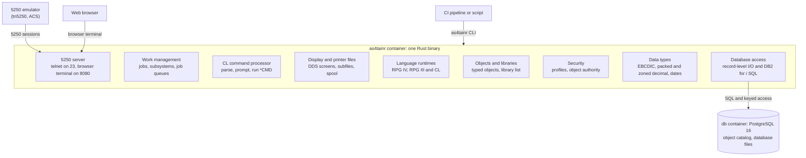

# AS4tainr: Architecture and Roadmap

This file is the master roadmap. Update it in the same commit as the work that changes it.

**Status (October 2026):** phases 0 to 3 have met their gates; phase 4 has not started.

## Vision and scope

AS4tainr is an open, containerized runtime that behaves like IBM i from the user's and developer's side: green-screen 5250 sessions, CL commands, libraries and objects, DB2-style database files, and RPG and CL programs. It runs anywhere Docker runs. No IBM code and no POWER hardware are involved.

**What it is:** a clean-room *compatible* environment. It works the way Wine runs Windows apps on Linux, by reimplementing the interfaces programs and people use. It does not emulate the CPU.

**What it is not:** a hardware emulator that boots real IBM i (SLIC/OS400) images. That path is blocked by missing POWER tags-active and PowerVM support in QEMU, by IBM's hardware-tied licensing, and by restricted install media. It stays a research track (see Risks).

**Who it is for, in priority order:**

1. **Legacy app hosting (primary).** Businesses run their existing RPG, CL and DDS applications on commodity Linux and cloud hosts, off Power hardware and IBM i licensing.
2. **Teams testing in CI** who want a disposable environment in a pipeline: `docker run`, compile, test, throw away.
3. **Developers and students** who need an IBM i-like box to learn on, without renting Power hardware.

**Definition of success for v1:** a typical green-screen order-entry application, made of DDS files, a display file, RPG IV and CL, compiles and runs unmodified. A user reaches it with a standard 5250 client such as tn5250 or IBM ACS.

## Legal and clean-room guardrails

The project is only viable if it never ships or derives from IBM code. The working rules for contributors are in [CONTRIBUTING.md](CONTRIBUTING.md). *(Not legal advice: have an IP lawyer review them before the public launch.)*

- **Build from public behavior and specs only.** Allowed sources are IBM's public documentation (IBM Docs, Redbooks, CL and DDS references), published RFCs (TN5250: RFC 1205, RFC 2877, RFC 4777), open-source projects with compatible licenses, and observed behavior on a legally licensed system such as PUB400.
- **Never use IBM binaries, disassembly, or licensed internal code.** Contributors certify this through a DCO sign-off on every commit.
- **Separate observers from implementers** wherever behavior is studied on a real system. Observers write behavior specs into the repo. Implementers code only from those specs.
- **Name with care.** "IBM i", "AS/400", "iSeries" and "DB2" are IBM trademarks. The product describes itself only as "IBM i-compatible" (nominative use) and uses no IBM logos or look-alike branding.
- **Treat command and API names as interface facts.** Reimplementing names like `CRTPF` or `WRKACTJOB` and their parameters follows the same reasoning that let Wine and ReactOS implement Windows APIs, and *Google v. Oracle* (2021) supports it. Message text and help text are written fresh.
- **Customer code stays the customer's.** Users may import their own source and data. The project ships with sample apps only.

## System architecture

Clients reach the platform through 5250 sessions, the browser terminal or the `as4tainr` CLI. All logic lives in one Rust binary. The database access layer translates IBM i-style record I/O and SQL into PostgreSQL. That layer is the hardest piece to get right, and every application depends on it.

## Core subsystems

Eight subsystems make up the platform. Two of them, the object model and the data layer, carry the most design risk. The data layer is where IBM i behaves least like ordinary Linux and SQL software.

| Subsystem | What it reproduces | How it is built | Phase |
| --- | --- | --- | --- |
| Object model and libraries | Typed objects (`*PGM`, `*FILE`, `*DTAARA`, `*USRPRF`, `*MSGQ`, `*OUTQ`), libraries (`QSYS`, `QGPL`, per-job `QTEMP`), library list resolution | An object store whose catalog lives in PostgreSQL. Libraries are PostgreSQL schemas. Names are 10-character EBCDIC-safe. | 0 |
| Data types and EBCDIC | CCSID 37/500/1047, packed and zoned decimal, date/time formats | A shared Rust core library with exact decimal arithmetic. It never uses floating point for business math. | 0 |
| 5250 server | Green-screen sessions, sign-on, function keys, subfiles | A TN5250 server on port 23, with TLS on 992 planned. A browser 5250 terminal covers zero-install access. | 0 |
| CL command processor | Command parsing, prompting (F4), `*CMD` definitions, CL programs | A table-driven command definitions engine. Commands are declared once as data and drive the parser, the prompter and the help. | 0–2 |
| Database | DDS physical and logical files, keyed record-level access (`READ`, `CHAIN`, `SETLL`), journaling, SQL | PostgreSQL as the storage engine. A record-level access layer sits on top, plus a DB2 for i SQL dialect translator. | 1 |
| Display and printer files | DDS `*DSPF` and `*PRTF`, record formats, indicators, subfiles | A DDS compiler to an internal screen model, rendered over the 5250 data stream. Printed output becomes spooled files. | 2 |
| Language runtimes | RPG IV (fixed, mixed and free form), RPG/400 (RPG III), ILE CL; COBOL later | A native RPG compiler and runtime in Rust, including the RPG cycle, embedded SQL and ILE binding. CL runs in a native Rust interpreter. | 2 |
| Work management and security | Jobs, subsystems (`QINTER`, `QBATCH`), job queues, `SBMJOB`, message queues, user profiles, object authority | A job scheduler in the core. Each job is an isolated execution context. Authority checks run on every object access. | 3 |

## Container and deployment layout

The platform ships as one `docker compose` stack ([docker-compose.yml](docker-compose.yml)) of two services and one persistent volume. The `as4tainr` service is a single Rust binary in a debian:bookworm-slim image.

| Service | Role | Ports | State |
| --- | --- | --- | --- |
| `as4tainr` | Object store, CL and RPG, jobs and subsystems, security, the 5250 server and the browser 5250 terminal | 23 (5250, published as 2323), 8080 (browser terminal, published as 5250) | Stateless |
| `db` | PostgreSQL 16: object catalog plus all database files | 5432 (internal only) | `pgdata` volume |

A `demo` profile runs the sample programs against their golden output (`docker compose run --rm demo`).

On first start, `as4tainr` builds the system libraries (`QSYS`, `QGPL`, `QUSRSYS`) and the `QSECOFR` profile with a forced password change, unless `AS4TAINR_QSECOFR_PASSWORD` is set. Interactive jobs run in `QINTER` and submitted jobs in `QBATCH`. A system backup is a backup of the `pgdata` volume.

## Technology stack

Rust for the core and for the RPG and CL runtimes, PostgreSQL for storage. With its own RPG compiler, the whole system is one Rust binary beside PostgreSQL.

| Layer | Choice | Why |
| --- | --- | --- |
| Core services | Rust | Memory safety, predictable performance, and exact decimal arithmetic. The compiler's strictness catches many bugs in AI-generated code. |
| Storage | PostgreSQL 16 | Transactions, journaling via WAL, and mature tooling. Keyed access maps onto B-tree indexes. |
| RPG runtime | Native RPG compiler and runtime in Rust ([docs/rpg-engine.md](docs/rpg-engine.md)) | Compiles fixed, mixed and free-form RPG IV and RPG III, and runs inside the core process. |
| CL runtime | Native Rust interpreter | CL is small and tied tightly to the command processor and job model. |
| 5250 server | Rust, async (tokio) | Many idle sessions at low cost. |
| Browser 5250 terminal | Plain JavaScript page served by the core process ([docs/web-terminal.md](docs/web-terminal.md)) | Zero-install access for users without a 5250 client. |
| Packaging | Docker images; multi-arch (amd64, arm64) planned | Runs on laptops, Apple Silicon and cloud. Podman-compatible. |
| Testing | Golden-output tests, to be captured from a licensed system | Fidelity is the product, and these tests are the main safeguard for AI-generated code. |

## Phased roadmap

Each phase ends at a gate that can be shown in a demo, and nothing moves forward until the gate passes. Phase 2's gate is v1: real-world RPG, CL and DDS code runs without changes.

| Phase | Scope | Exit gate | Status |
| --- | --- | --- | --- |
| 0 · Foundations | Object store, EBCDIC and decimal library, TN5250 server and sign-on, CL shell | Sign on with tn5250, run `CRTLIB` and `DSPLIB` | Met |
| 1 · Data | DDS physical and logical files, record-level access, SQL in the DB2 for i dialect | `CRTPF` from DDS, then read it with RLA and SQL | Met |
| 2 · Programs (v1) | CL compiler (`CRTBNDCL`), RPG IV in fixed and free form, display files and subfiles | Sample order-entry app runs unmodified | Met ([docs/order-entry.md](docs/order-entry.md)) |
| 3 · Operations | Jobs, subsystems, `SBMJOB`, spooled files, message queues, user profiles, object authority | Multi-user interactive and batch workload | Met (`tools/gate3_5250.py`, run in CI) |
| 4 · Ecosystem | ODBC/JDBC and ACS host servers, COBOL, TLS 5250, `SAVLIB`/`RSTLIB` | ACS and ODBC tools connect unchanged | Not started; real-app readiness comes first |

The gates were met with the project's own sample apps, so real legacy code is the next test.

### What runs today

- **RPG:** RPG IV in fixed, mixed and free form up to IBM i 7.5 (date built-ins, FOR-EACH, IN, DCL-ENUM, OVERLOAD, SND-MSG). RPG/400 (RPG III) builds with CRTRPGPGM and converts with CVTRPGSRC. The full RPG cycle runs: control levels, matching records, program-described files, edit words. CVTRPGFREE converts fixed form to free.
- **RPG runtime:** status codes, the program status and file information data structures, \*PSSR, INFSR and ENDSR return points, overflow and fetch overflow, the local data area (\*LDA), and files declared in procedures. Pointers: %ADDR, BASED storage, pointer arithmetic, %ALLOC/%REALLOC/DEALLOC, %STR and OPTIONS(\*STRING).
- **ILE:** modules, service programs and binding directories (CRTRPGMOD, CRTSRVPGM, CRTPGM, binder language); activation groups, signature checking, exported data, and CL modules (CALLPRC).
- **SQL:** embedded SQL (SQLRPGLE, CRTSQLRPGI) with cursors, prepared statements, host structures and null indicators. SQL DDL (CREATE SCHEMA, CREATE TABLE, CREATE INDEX, ALTER TABLE, DROP, LABEL ON, GRANT) and RUNSQLSTM (from a member or a stream file) create real files that RPG reads and writes, with long names, views, identity columns, foreign keys, SQL triggers (which fire for record-level access too), CREATE TABLE AS, and the SQL data types including DECFLOAT, BOOLEAN, XML and TIMESTAMP(p). SQL procedures and functions (CREATE PROCEDURE, CREATE FUNCTION, compound statements with handlers, cursors and loops), CALL from STRSQL, RUNSQL, RUNSQLSTM and embedded SQL, dynamic compound statements, external procedures over RPG and CL programs, and SQL table functions. IBM i services: the QSYS2 catalog views (SYSSCHEMAS, SYSTABLES, SYSCOLUMNS, SYSINDEXES, SYSKEYS, SYSVIEWS, SYSROUTINES, SYSPARMS), OBJECT_STATISTICS, LIBRARY_LIST_INFO, USER_INFO, SYSTEM_VALUE_INFO, JOBLOG_INFO, ACTIVE_JOB_INFO, IFS_READ, IFS_WRITE and QCMDEXC; JSON_TABLE.
- **Journals and trigger programs:** CRTJRNRCV, CRTJRN, CHGJRN, STRJRNPF, ENDJRNPF, DSPJRN, APYJRNCHG, RMVJRNCHG; every record change journaled (R PT/UB/UP/DL) with commit cycles (C SC/CM/RB) and rollbacks (R DR/BR/UR), read with QSYS2.DISPLAY_JOURNAL and INTERPRET; ADDPFTRG trigger programs called with IBM's trigger buffer for RPG, SQL and CL changes, in the session and commit scope of the change, *BEFORE programs before it (ALWREPCHG), errors handled by IBM's commitment control rules (CPF502B, SQL0443).
- **Commitment control:** STRCMTCTL, ENDCMTCTL, COMMIT and ROLLBACK in CL, RPG files with the COMMIT keyword and COMMIT/ROLBK, and embedded SQL under its commit level; pending changes roll back when the job ends.
- **CL:** program message queues (SNDPGMMSG, RCVMSG from the program's, its caller's and user message queues with WAIT, RTVMSG) and message files (CRTMSGF, ADDMSGD), files in CL (DCLF, RCVF, SNDF, SNDRCVF), overrides (OVRDBF, OVRPRTF, DLTOVR), subroutines (SUBR, CALLSUBR), parameters passed by reference between CL and RPG programs, RTVOBJD, RTVMBRD, CLRPFM, DLYJOB, RTVSYSVAL and the newer CL built-ins.
- **IFS:** directories and stream files with CCSIDs, the C runtime and UNIX-type APIs bound from QC2LE (open, read, write, close, lseek, unlink, mkdir, errno, strerror, string and memory functions, system()), and the CL commands MKDIR, RMVDIR, RMVLNK, RNM, WRKLNK, CPYTOSTMF and CPYFRMSTMF.
- **Real applications:** `tools/legacy.sh` installs Northwind for IBM i (its SQL database, then its own CL build program builds 13 SQLRPGLE service programs, 14 display files and 15 programs) and the COM order management application (customer, item and order maintenance with message subfiles and the QMHSNDPM API), and both run on a 5250 display.
- **System:** commands made with CRTCMD, DDS printer files (CRTPRTF), READ of a display record, and CL defined and based storage.

50 corpus objects (43 programs, 4 modules, 3 service programs) and 6 commands build; most remaining corpus failures would fail on IBM i too (see docs/import.md). Known gaps are listed in [docs/fidelity-gaps.md](docs/fidelity-gaps.md).

## Risks

The biggest risk is the size of the surface to cover. IBM i has thousands of CL commands and system APIs, and real applications use a long tail of them. We manage this by building to the needs of real sample apps, not to the whole manual.

| Risk | Impact | Mitigation |
| --- | --- | --- |
| Solo, AI-assisted development: plausible-looking code that is subtly wrong, plus a bus factor of one | Silent errors in decimal math, locking, or record I/O | Golden-output tests. Human review of every change to the decimal and database layers. Design docs and CLAUDE.md in the repo so any session or contributor can pick up the work. |
| Surface area: commands, APIs (`QSYS` APIs, `QUSRSPC`), RPG opcodes and BIFs | Legacy apps fail on the first unsupported call | Build a corpus of legacy-style RPG/CL apps. Implement in order of usage frequency. Unsupported calls fail with a clear `CPF`-style message. |
| Fidelity drift: decimal rounding, record locking, commitment control | Silent wrong answers, the worst failure for business software | Golden-output tests against a licensed system. Exact-decimal-only arithmetic. |
| Clean-room contamination | Legal exposure for the project | Guardrails above, DCO, and clean-room rules written into CLAUDE.md. |
| Trademark complaints | Forced rename after launch | The name "AS4tainr" evokes IBM's AS/400 mark ("AS4"). Get a trademark opinion before the public launch, and keep a fallback name ready. Use "IBM i-compatible" wording only. |
| Host-server protocols (ODBC/JDBC, ACS file transfer on ports 8470–8476) | Existing desktop tools can't connect, which matters for hosted legacy apps | Phase 4. IBM's open-source JTOpen toolbox documents the protocols in code. |
| Hardware-level emulation stays out of reach | No path to running real IBM i images | Keep it as a separate research track. Revisit only if IBM licensing changes. |

## Decisions

- **Name:** AS4tainr. The project will be public on GitHub after the first release, to attract contributors.
- **License:** Apache-2.0 ([LICENSE](LICENSE)).
- **Core language:** Rust.
- **Audience:** legacy app hosting first; a training environment second.
- **Fidelity:** as close to IBM i as possible. When IBM behavior and convenience differ, follow IBM.

## Next steps

- [x] Get access to a real system and capture golden outputs: PUB400 (IBM i 7.5) over SSH, `tools/golden/`, `tools/golden_compare.py`, docs/golden-outputs.md. First results: the PASE `system` utility's streams and exit statuses, completion message IDs, and the printed reports of DSPLIBL, DSPDTAARA, DSPSYSVAL, DSPOBJD and DSPFD *ATR.
- [x] Golden comparison of command messages: `tools/golden.py` over whole capture lists (exit statuses, message IDs on each stream), a clean-room audit of message texts, the command analyzer's diagnostics (CPD0013...CPD0170) before CPF0006, completion message IDs of the create, change and delete commands captured, CPYF, DSPFFD, DLTPGM, SRCSTMF on the compilers.
- [x] Golden round 4, files and programs (40 of 43 the same; the rest are PUB400 side): CPYF's escape and information messages (CPF2802, CPF2861, CPF2963, CPF2863 with CPF2817; CPF2880, CPF2889, CPF4011), CPYF *PRINT with CPC2955, save file messages (CPC3722, CPC3725, CPF3770), DSPOBJD CPF2105, DLTOVR CPF5809, CPF0001 for a refused command inside a CL program. A 5250 screen capture client for Windows with no installs (`tools/golden/screens.ps1`, `Tn5250Capture.cs`).
- [x] 5250 screens from PUB400 (tools/golden/screens.ps1, 23 screens): Command Entry and the command prompt laid out as IBM i 7.5 draws them, message texts without IDs on 5250 displays, a command missing a required parameter is prompted, F3/F12 on a prompt logs CPF6801.
- [x] 5250 screens round 2 (screens2.txt): DSPLIB, DSPLIBL, DSPDTAARA, DSPOBJD, WRKOBJ, WRKSPLF (F11 second view), DSPJOBLOG and DSPMSG in IBM i's layouts, the MAIN menu header, Command Entry F10 (all request levels), CRTDTAARA prompt control and *CURLIB defaults on create commands.
- [x] 5250 screens round 3 (screens3.txt): element lists on prompts (CRTDTAARA LEN, CRTPRTF DEV), CRTPRTF's first screen with the rest under F10, DSPDTAARA of *DEC values, WRKACTJOB, WRKSBMJOB and DSPUSRPRF in IBM i's layouts, Page Up/Down through Command Entry's log, F16 on the system menus.
- [x] RPG and SQL golden values (tools/golden/rpg-sql.txt, 121 of 122 the same): Db2 CHAR/DIGITS/TIMESTAMP/VARCHAR_FORMAT, CAST truncation, labeled durations, Db2's decimal division scale, ROUND/TRUNCATE keep the scale, floating-point constants; RPG %EDITC X and Z and N-Q sign position, %EDITC with *ASTFILL/*CURSYM, date formats with separators, RNS9304 from CRTBNDRPG.
- [x] RPG precision rules: intermediate results of +, -, * and / follow the ILE RPG rules with the 30 digits IBM i 7.5 uses (63 when an operand has more than 30); literals count their own digits (tools/golden/rpg-prec.txt, all values the same).
- [x] Compiler listings and DSPMSGD: CRTBNDCL and CRTBNDRPG print their listings in IBM i 7.5's layout with the compilers' checks (CL CPD0727/CPD0030/CPD0726/CPD0791, RPG RNF7030/RNF7503/RNF7416/RNF7086; CPF0820, RNS9308/RNS9310), DSPMSGD prints its formatted, unformatted and basic reports (tools/golden/listings.txt).
- [x] More compiler listings: CRTRPGMOD, CRTCLMOD, CRTSQLRPGI (precompiler listing) and CRTRPGPGM (RPG/400) listings, /COPY members, generated input and output specifications, fixed-form source, RNF7031 (tools/golden/listings2.txt).
- [x] Screens round 4: the Display Spooled File viewer (DSPSPLF; DSPFD and DSPFFD on a display), compiler listings as spooled files of their pages, Command Entry's continuation lines, PDM (WRKMBRPDM, WRKOBJPDM), WRKMSGD, RMVM, DSPFFD's report, DLTF of a source file (tools/golden/screens4.txt).
- [x] Data queues and user spaces: CRTDTAQ, DLTDTAQ, QSNDDTAQ, QRCVDTAQ (waits, keys, sender information), QCLRDTAQ, QMHQRDQD; QUSCRTUS, QUSDLTUS, QUSRTVUS, QUSCHGUS, QUSRUSAT, QUSCUSAT, QUSPTRUS; the list APIs QUSLMBR and QUSLOBJ with the generic header; ERRC0100 error codes, from CL and RPG (docs/data-queues.md).
- [x] Retrieve and list APIs: QUSROBJD, QUSRMBRD, QUSRSPLA, QUSLFLD and QUSLSPL from CL and RPG (docs/data-queues.md).
- [x] Output queues and spooled file commands: CRTOUTQ, DLTOUTQ, CLROUTQ, HLDOUTQ, RLSOUTQ, WRKOUTQ, HLDSPLF, RLSSPLF, CHGSPLFA, WRKSPLFA, WRKSPLF options 3/6/8 at IBM's columns, the user profile's OUTQ (docs/spooled-files.md).
- [x] Corpus 2, IBM's company_system sample: everything but two objects builds (both would fail on IBM i too). Added along the way: binder source next to its module, Rules.mk member names, SQL source types, CRTSQLRPGI COMPILEOPT, more FOREIGN KEY forms, RPG LIKE of a data structure, about 40 Db2 for i scalar functions and special registers (LOCATE, TRANSLATE, STRIP, INT, VARCHAR, DATE, HEX, RAND, ADD_MONTHS, MONTHS_BETWEEN, TIMESTAMPDIFF, LISTAGG, CURRENT USER/SERVER...), and SQL variables never replacing INSERT and UPDATE target columns
- [x] Corpus 3, OSSILE: 54 objects build; the 17 that do not would fail on IBM i too or need C. Added along the way: procedure pointers, the ILE CEE APIs (dates, heaps, CEEDOD), QlgConvertCase, QWCRNETA, more of the C runtime, a QSYSINC library, build rules from Makefiles and setup scripts, copy members by file name, Windows-1252 source, and RPG compiler fixes (long names, LIKEDS forward references, INZ(*LIKEDS), overlay arrays with SORTA, program-described files opened by EXTFILE)
- [x] Corpus 4, RPGUnit (CPL-1.0): installed by its own MKMETADATA and MKRPGUNIT, its self-test MKRPGUNITT passes the sanity check and all ten unit test suites (call stack and program message APIs, QGYOLJBL, overrides scoped to activation groups, procedure pointers into service programs); 10 of 22 acceptance tests pass, the rest need the spooled file APIs
- [x] Spooled file APIs (QGYOLSPL, QGYGTLE, QSPOPNSP, QSPGETSP SPFR0300, QSPCLOSP), OVRPRTF SPLFNAME/USRDTA, `as4tainr batch`, PASE `system` printed output as on IBM i: RPGUnit's whole self-test passes, all 22 acceptance tests included
- [x] Real-world corpus 5, QshOni (MIT): built by its own build.sh; environment variables (ADDENVVAR, CHGENVVAR, RMVENVVAR, WRKENVVAR, getenv/putenv), QSH/STRQSH with QIBM_QSH_CMD_OUTPUT and QSH0005/QSH0006 (opt-in AS4TAINR_QSH), source files read by record, CHGLIB, CL expressions as parameter values and `LIB/*ALL` qualifiers
- [x] QSH commands work on the IFS: the IFS mirrored to disk and bound at its paths in a mount namespace per command, changes written back (docs/qshell.md)
- [x] Character keys in EBCDIC order: an ICU collation in CCSID 37 byte order for character columns (keyed reads, logical files, SQL ORDER BY and comparisons), earlier databases changed at catalog initialization; CL compares in EBCDIC
- [x] QTEMP per job: each interactive session, batch job and `system`/`call` process gets its own temporary library, empty at its start and deleted at its end; QTEMP names it in commands, the library list, SQL and APIs
- [x] Save and restore OMITOBJ and SELECT (*INCLUDE/*OMIT by object, type, attribute), FILEMBR(*ALL), the other save/restore parameters accepted; DSPATR; QTEMP returned as QTEMP by the list, retrieve and spooled file APIs
- [x] Object, library and member lists in EBCDIC order (DSPLIB, WRKOBJPDM, WRKMBRPDM, QUSLOBJ, QUSLMBR); ADDPFM for source members
- [x] SAVCHGOBJ: object change times kept (RTVOBJD CHGDATE, QUSROBJD, OBJECT_STATISTICS), changed records since the last SAVLIB or a reference date, OBJJRN
- [x] The job's current directory (CHGCURDIR, CD, chdir, getcwd; relative paths; `system` starts in its shell's directory), printf/puts to standard output, `--curlib`; IBM's Company System built as its makefile does (tools/legacy.sh)
- [x] REXX procedures: STRREXPRC, CRTCMD PGM(*REXX), the language and its built-in functions, CL commands with &variables (docs/rexx.md)
- [x] iRPGUnit installs with its own A_INSTALL REXX procedure; RUCRTRPG and RUCALLTST run its ASSERTT self-test suite (19 of 22 procedures pass; tools/legacy.sh)
- [x] CVTDAT, CRTDUPOBJ, job descriptions (CRTJOBD, CHGJOBD, DLTJOBD, DSPJOBD, SBMJOB JOBD), CHGCMD; APIs QDBRTVFD, QLICOBJD, QUSROBJD OBJD0300/0400, QUSRJOBI, QSZRTVPR, QSPRILSP, QCAPCMD, RCVM0200
- [x] RPG: timestamps with 0-12 fractional digits, 63-digit decimals, DECEDIT for %CHAR, date + time, literal continuation, OVERLOAD by exact type, operational descriptors of temporaries, EXTPROC(*DCLCASE) names
- [x] Message queues: CRTMSGQ/DLTMSGQ, SNDMSG TOMSGQ, QGYOLMSG (LSTM0100)
- [x] Pointer storage per call vs activation (callbacks into running modules); based items past their variable; freed heap readable
- [x] RPG: INZ of nested LIKEDS, %LEN assignment, program-described printer WRITE with DS, RPG calls to bound CL modules
- [x] APIs: QUSRJOBI JOBI0400, QWDRJOBD, QGYOLSPL OSPF0200, binary message keys, QMHRCVPM by key, QMHRMVPM on call stack queues
- [x] SQL special registers per statement; spooled file numbers not reused; iRPGUnit self-tests: 10 suites pass
- [x] XML-SAX with %HANDLER (all XML events, doc=string and doc=file)
- [x] Message APIs: receive by key from ended entries, full-length receivers, job log sender/receiver fields; iRPGUnit PGMMSGT and MSGQT pass
- [x] Call backs into a running bound module see its live globals; CHKOBJ OBJTYPE validation; QCAPCMD CRTSQLRPGI order
- [x] RPG INZ(*LIKEDS) through nested LIKEDS subfields, DS arrays and procedures; indicator + indicator concatenates
- [x] RPG run-time errors signaled as RNX escape messages (MONITOR, ON-EXCP, PSDS, job log); OPTIONS(*TRIM)
- [x] C runtime: localtime_r/gmtime_r/mitime fill CONST-declared buffers; waittime waits; CRTSQLCBLI defined (QCAPCMD order)
- [x] iRPGUnit self-tests: STRINGT and STMFT pass; XMLSTMFT 261/264; CRTTSTT no failures
- [x] Compiled RPG programs/modules kept per process with a file/member/IFS change stamp (iRPGUnit self-tests 4x faster; TESTUTILST passes)
- [x] rpgle-repl (TOBi project) imported and running: TOBi builds from the IFS with makei defaults, IFS include search order, EVAL-CORR, OPTIONS(*CONVERT), %LOOKUP over DS arrays
- [x] SQL: auditing/generated columns, RENAME TABLE, CREATE/DROP ALIAS (incl. source members), QSYS2.JOB_NAME, system column names, OVRDBF in embedded SQL, dynamic DDL, SYSTOOLS.SPOOLED_FILE_DATA
- [x] CL: CRTSRCPF full parameters with MBR; qualified commands checked in their library
- [x] SQL: DECLARE GLOBAL TEMPORARY TABLE (QTEMP/SESSION), DEFAULT USER, ALTER TABLE with several alterations, Db2 implicit string/number casts
- [x] Display files: keyboard shift D, usage P; CL: positional IF/ELSE commands
- [x] Import: IBM-i-RPG-Free-CLP-Code (relative-path includes from the IFS, commands before programs)
- [x] Import: IBMi-topics (MarcoDeSenas): TOBi projects fully in the IFS, CL INCLUDE SRCSTMF relative paths, NAME.srvpgm sources as EXPORT(*ALL) service programs; SPLFDLT runs end to end
- [x] Commands: CMD statement VLDCKR/ALLOW/MAXPOS/TEXT, PARM RTNVAL(*YES), validity checker called by QCATRS; CL DCLPRCOPT binding, CALLPRC _MATPGMNM, CL programs listed by QWVRCSTK
- [x] SQL: QSYS2.QCMDEXC scalar function in SQL PL, SYSTOOLS.LPRINTF, QSYS2.ENVIRONMENT_VARIABLE_INFO (ENV_VARS, also as RPG EXTNAME)
- [x] QUSLSPL SPLF0300; DDS relative positions (+n); RPG LIKE of an outer field inside a qualified DS
- [ ] System-period temporal tables (ROW BEGIN/END, TRANSACTION START ID, PERIOD SYSTEM_TIME, ADD VERSIONING, FOR SYSTEM_TIME queries)
- [x] PUB400-verified spooled file data: QSPGETSP SPFR0300 header and SCS print data, `system` print job (QPRTJOB), DSPSPLF CPD0031
- [x] CRTCMD/CMD ALLOW enforced (CPD0031); QCMDEXC scalar function in plain INSERT/UPDATE/DELETE/MERGE
- [x] Clean-room audit at 0: message texts that matched IBM's rewritten
- [ ] DSPFD/DSPOBJD OUTPUT(*OUTFILE) with model files QAFDMBRL/QADSPOBJ (needs DSPFFD capture from PUB400)
- [ ] Golden output coverage: CL command messages and reports (DSPFD of keyed and logical files, DSPPFM, WRKOBJ, DSPJOBLOG), RPG results (decimal arithmetic, %EDITC/%EDITW, date formats), SQL (`db2` in QSH), 5250 screens over the SSH tunnel; completion message IDs for every create and delete command.
- [x] Run real applications end to end and fix what they need: Northwind for IBM i and COM order management (`tools/legacy.sh`, docs/import.md).
- [x] Journals and trigger programs: COM's SETUPJRN, ORDAUDJV (QSYS2.DISPLAY_JOURNAL) and ORDTRG (ADDPFTRG) run (docs/journals.md).
- [ ] A third real application, fixed-form heavy (JCRCMDS, if its download can be used for testing).
- [x] Journal and trigger depth: APYJRNCHG/RMVJRNCHG, rolled-back changes in the journal, trigger programs in the caller's commitment definition, *BEFORE triggers changing the record (ALWREPCHG) (docs/journals.md).
- [ ] Trigger extras: *READ triggers, CL trigger programs, a trigger program's embedded SQL in the change's session.
- [x] RPG language gaps: dates and times held in their DATFMT/TIMFMT (MOVE with formats, %CHAR, %DEC), XML-INTO, LIKEFILE/TEMPLATE/file parameters, EXTFILE, halt indicators, PSDS creation and source information (docs/rpg-engine.md).
- [ ] RPG extras: XML-SAX, XML-INTO %HANDLER, DATA-INTO and DATA-GEN (the QrnDi* interface), /SET and /RESTORE, *GDA and *PDA.
- [x] Close the SQL gaps: commitment control, compound statements, routines.
- [x] IBM i SQL services: sequences, INSTEAD OF triggers, SYSCST/SYSKEYCST/SYSCHKCST/SYSREFCST/SYSTRIGGERS/SYSSEQUENCES, JOB_INFO, OUTPUT_QUEUE_ENTRIES, OBJECT_PRIVILEGES, JSON_OBJECT/JSON_ARRAY/JSON_ARRAYAGG/JSON_OBJECTAGG/JSON_VALUE/JSON_QUERY/JSON_EXISTS (docs/sql.md).
- [ ] Remaining SQL: external functions, more scalar functions (CHAR, VARCHAR_FORMAT...), more IBM i services, LABEL ON SEQUENCE.
- [x] C runtime and IFS procedures (open, read, write, close) for RPG, with pointers.
- [ ] IFS beyond the basics: stat() and directory APIs, CPYTOIMPF/CPYFRMIMPF, procedure pointers, pointers between programs, IFS authority checks.
- [x] Save and restore: SAVOBJ, SAVLIB, RSTOBJ, RSTLIB to save files in a portable archive format, DLTLIB/CLRLIB, save files moved between systems with CPYTOSTMF/CPYFRMSTMF; APYJRNCHG's *LASTSAVE defaults work (docs/save-restore.md).
- [ ] Save extras: SAVCHGOBJ, saving journals and receivers, ALWOBJDIF checks.
- [ ] Packaging: TLS on port 992, multi-arch images (amd64, arm64).
- [ ] Get a trademark opinion on the name before the public launch.
- [ ] Phase 4: ODBC/JDBC and ACS host servers, so existing tools connect.
